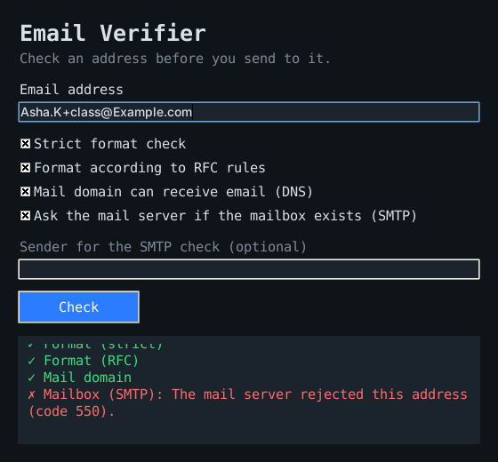

# Email Verifier

Email Verifier is a simple Python application built with Tkinter that allows you to check the validity and verify email addresses. It provides options to perform strict regex tests, test according to RFC guidelines, check the availability of the mail domain, and verify the email using smtplib.



## Requirements

- Python 3.9+ with Tkinter (on Debian/Ubuntu: `sudo apt install python3-tk`)
- [dnspython](https://www.dnspython.org/): `pip install -r requirements.txt`

## Usage

1. Clone the repository or download the source code files.

2. Run the application by executing the `application.py` file:

```bash
python application.py
```

3. The Email Verifier window opens. Press Enter or click **Check**; results appear in the
   window as each check finishes (✓ passed, ✗ failed, ? couldn't tell).

4. Enter the email address you want to verify in the "Enter an email address" field.

5. Choose the checks to run:

   - **Strict format check**: practical syntax check (any letter case, `+tags` allowed).
   - **Format according to RFC rules**: looser RFC 5322 syntax, including quoted names.
   - **Mail domain can receive email**: looks up the domain's MX records (or an address
     record, per RFC 5321) and picks the highest-priority server.
   - **Ask the mail server if the mailbox exists**: talks SMTP to that server. Domains that
     accept every address ("catch-all") and networks that block outbound port 25 are
     reported as *couldn't tell* rather than *invalid*. You can optionally set the sender
     address used for this check.

## Using the checks in code

```python
from verifier import Email_Verifier

v = Email_Verifier("someone@example.com")
v.check_regex(), v.check_domain(), v.verify_email()   # verify_email: True / False / None
print(v.last_reason)
```

## Tests

```bash
pip install -r requirements-dev.txt && pytest
```

## Notes

- The email address verification is based on regex patterns and domain availability checks. While it ensures basic compliance with RFC guidelines, it may not cover all possible valid or invalid email address variations.

- The "Verify Email using smtplib" option relies on an active internet connection and may not work for certain email addresses or in some network environments.

## Contributing

Contributions to this project are welcome! If you find any issues or have suggestions for improvements, please feel free to open an issue or create a pull request.

## License

This project is licensed under the Apache License. See the [LICENSE](LICENSE) file for details.

## Credits

- [OpenAI's GPT-3.5](https://openai.com/) for providing the AI assistant that helped in creating this README.
- [RFC Email](https://haacked.com/archive/2007/08/21/i-knew-how-to-validate-an-email-address-until-i.aspx/)
- [Email Verifier](https://www.scottbrady91.com/email-verification/python-email-verification-script)
- Tkinter-based GUI interface for the application.
